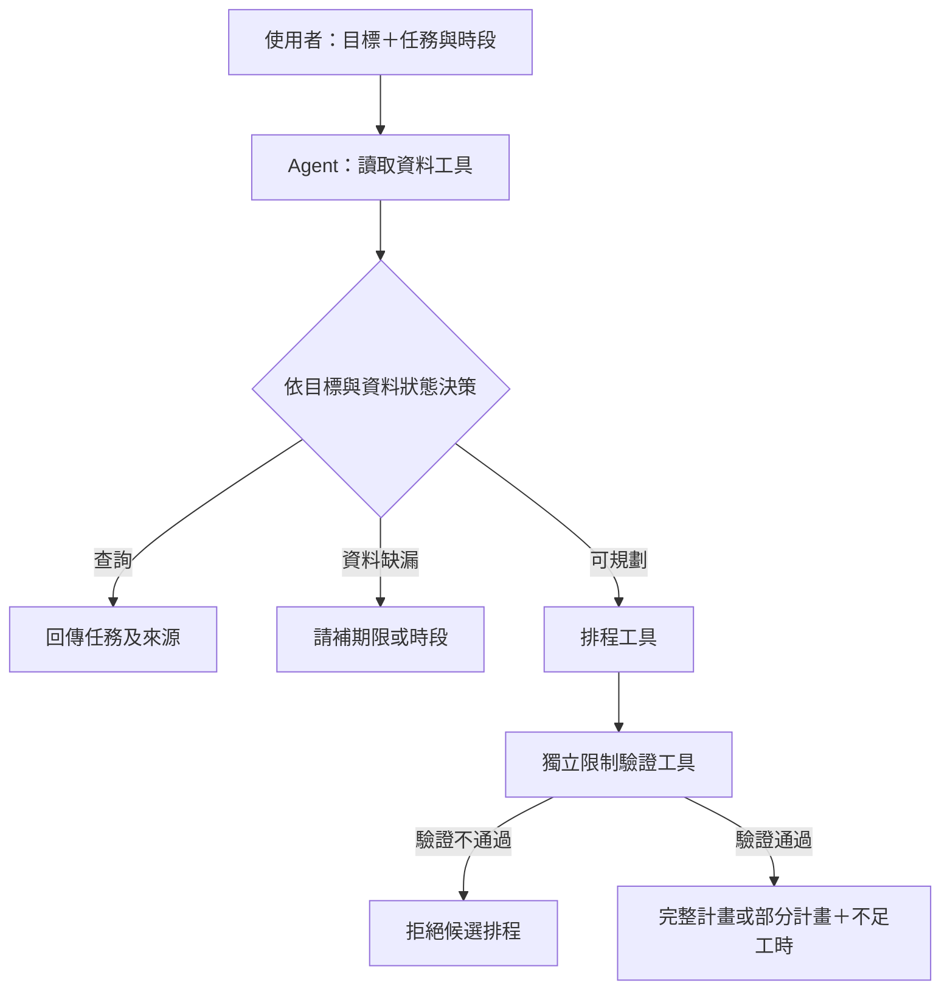

# CoursePilot 個人專案｜作業 2

CoursePilot 將已確認的課程任務與可用時段轉成可檢查的學習計畫。這一版是在作業 1 基礎上完成的可執行原型：可查任務、產生排程，或依新的時段與完成狀態重新安排。使用 CLI 及 JSON，無需模型、API 金鑰或外部 Python 套件。

## 1. 用 Podman 執行

系統需求：Podman；首次建置需能拉取 Python 3.12 slim 映像。Windows 或 macOS 若尚未建立 Podman VM，執行 `podman machine init --now`；已有但停止的 VM 執行 `podman machine start`。Linux 可直接使用 Podman。見 [Podman 官方說明](https://docs.podman.io/en/stable/markdown/podman-machine-init.1.html)。

在含有 Containerfile 的目錄執行：

```text
podman build -t coursepilot:hw2 .
podman run --rm --network none coursepilot:hw2 tasks --case success
podman run --rm --network none coursepilot:hw2 plan --case success
podman run --rm --network none coursepilot:hw2 replan --case changed
podman run --rm --network none coursepilot:hw2 plan --case unknown
podman run --rm --network none coursepilot:hw2 plan --case short
podman run --rm --network none --entrypoint python coursepilot:hw2 -m unittest discover -s tests -v
```

預期狀態依序為 `ok`、`ok`、`ok`、`needs_deadline`、`insufficient`。執行時網路可關閉。查詢 VM 狀態用 `podman machine list`；若卡在拉取映像，先檢查 registry 連線。出現 `data_error` 時，查看 trace 中的 observation。輸入待確認與部分排程屬正常業務結果，退出碼為 0；資料錯誤或排程驗證失敗退出碼為 2。

## 2. 調整資料再重新排程

複製 `data/changed.json` 為 `my-case.json`，將已完成工作標為 `done`，再修改可用時段。以本機 Python 3.12 快速開發或查錯：

```text
python -X utf8 coursepilot.py replan --file my-case.json
python -X utf8 -m unittest discover -s tests -v
```

正式容器演示可直接使用內建案例。若要將自備資料放入容器，可在映像後用唯讀掛載（Linux Bash 範例，Podman VM 上需使用 VM 可讀取的路徑）：

```bash
podman run --rm --network none -v "$(pwd)/my-case.json:/tmp/my-case.json:ro,Z" coursepilot:hw2 replan --file /tmp/my-case.json
```

- `tasks`：每筆包含唯一 `id`、`title`、`source`、`status`（`pending`／`done`）、`minutes`（正的 30 倍數）及 `due`（期限不明可用 `null`）。
- `windows`：每筆包含 `start`、`end`；使用 ISO 8601、`+08:00`，對齊整點或半點。時段總範圍最多七天，重疊時段會去重。請事先扣除打工等固定活動。
- 輸出為 JSON，含 `status`、`message`、適用時的 `schedule`／`remaining_minutes`，以及按順序排列的 `trace`。此版讀取最新輸入快照，不會修改輸入或儲存計畫。


# CoursePilot 作業 2 技術說明

## 專案延續與架構

學生輸入查詢、排程或重新排程目標，Agent 讀取已確認的課程任務與時段，依當前狀態選擇工具，再用驗證結果決定回傳完整計畫、部分計畫或要求補件。本階段對應作業 1 的 FR-04（可用時段輸入部分）、FR-07、FR-08（以更新後的資料重新規劃）、FR-09（期限缺漏及時段不足）及 FR-10（追蹤部分）。輸入以 JSON 模擬作業 1 的已確認任務，source 欄位保留原始人工標註。



除使用者操作的終端外，Agent、工具與測試都由一個 Podman 容器執行。一次請求的狀態包含目標、資料、候選排程、檢查結果與事件追蹤。這是 goal-based、state-based Agent：依工具觀察走不同分支。未採用 LLM ReAct，因為這一階段只有三個明確目標與有限的工具順序，程式化分支即可驗證。工具追蹤採用 Decision → Tool Call → Observation 格式，並非模型思考紀錄。

## 工具定義

| 名稱 | 目的 | 輸入 | 輸出 | 錯誤處理 |
|---|---|---|---|---|
| `load_case` | 實際讀取並驗證檔案 | JSON 路徑 | 任務與時段 | 檔案或格式錯誤記錄 observation，回傳 `data_error` |
| `build_schedule` | 依較早期限優先配置，每塊 30 分鐘 | 已確定期限的待辦、已驗證時段 | 包含 ID、開始及結束的區塊 | 無合法區塊時保留部分或空計畫，交由驗證器計算未排工時 |
| `validate_schedule` | 獨立檢查候選計畫 | 待辦、時段、候選區塊 | `valid`、`errors`、`remaining_minutes` | 拒絕未知任務、重疊、過期、超額或非法時段；Agent 不輸出錯誤候選 |

排程工具將重疊可用時段轉成不重複的半小時區塊，再將可分割任務依期限排序。驗證不依賴排程的結果標記，會重新計算每項工作配置量；沒有錯誤但尚有未安排工時時，狀態為 `insufficient`。

## 實際完整追蹤

對應 [原始 JSON](../evidence/success.json)；由 CLI 實際執行產生。

| 步驟 | 事件 | 觀察到的內容 |
|---|---|---|
| 1 | User Input | `plan --case success` |
| 2–4 | Decision → Tool Call → Observation | 呼叫 `load_case`；讀到 DB01（90 分鐘）、AI01（60 分鐘）及兩段可用時段 |
| 5–7 | Decision → Tool Call → Observation | 期限與時段均已提供，呼叫 `build_schedule`；取得五個 30 分鐘區塊 |
| 8–10 | Decision → Tool Call → Observation | 呼叫 `validate_schedule`；取得 `valid: true`，無錯誤、無未排工時 |
| 11–12 | Decision → Result | 採用完整計畫，`status: ok`；DB01 三塊、AI01 兩塊，保留任務來源 |

## 失敗情境與測試證據

| 情境 | 原因 | 處理及實際結果 |
|---|---|---|
| [期限不明](../evidence/unknown.json) | 公告只有「下週五」，沒有參考日期 | 讀取後停止排程，回傳 `needs_deadline`；請確認 DB01 日期後重跑 |
| [期限前容量不足](../evidence/short.json) | 雖有 90 分鐘可用時間，但期限前只有 30 分鐘 | 回傳 `insufficient`，僅列合法的 30 分鐘區塊，DB01 尚缺 60 分鐘；建議增加期限前的可用時段 |
| 候選計畫錯誤 | 測試注入未知任務的區塊 | Agent 回傳 `invalid_schedule`，不提供錯誤候選；驗證器也另測重疊與超期 |
| [重新規劃](../evidence/changed.json)（對照成功） | DB01 已完成且時段改成週四 | `ok`；只排 AI01，使用新時段 |

[本機測試紀錄](../evidence/tests.txt)：10 項通過，涵蓋成功追蹤、重新規劃、資料錯誤、未確認期限、容量不足與驗證分支。容器驗證尚待具備 Podman 的環境或 GitHub Actions 執行。
